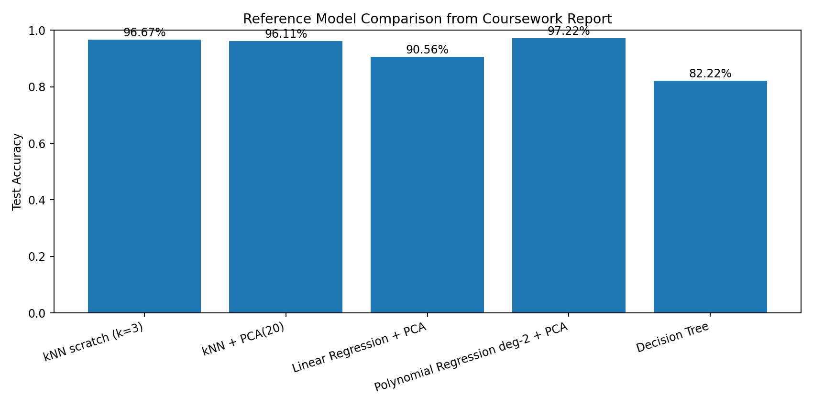

# Handwritten Digit Classification — ML Models from Scratch

A machine-learning comparison project using the **scikit-learn Digits dataset** (1,797 samples, 64 pixel features, 10 digit classes).

The project compares several supervised-learning approaches, with three core algorithms implemented largely from scratch in NumPy:

- k-Nearest Neighbours (kNN) — from scratch
- Multiclass Linear Regression — from scratch
- Degree-2 Polynomial Regression — from scratch
- Principal Component Analysis (PCA) — scikit-learn
- Decision Tree classifier — scikit-learn baseline

## Project highlights

- 1,797 handwritten digit samples, each represented by an 8×8 image
- stratified 80/20 train-test split
- missing-value and class-balance checks
- training-only feature standardization to prevent leakage
- NumPy-only accuracy, precision, recall, F1 and confusion-matrix utilities
- Euclidean-distance kNN with majority voting implemented from scratch
- multiclass linear regression using one-hot targets and mini-batch gradient descent
- degree-2 polynomial feature expansion implemented from scratch
- PCA dimensionality reduction from 64 to 20 components
- L2 regularization and gradient clipping for regression models
- comparison against a library Decision Tree baseline
- class-level error analysis and model-comparison visualizations

## Reference results from the coursework report

| Model | Test Accuracy |
|---|---:|
| kNN from scratch (k=3) | **96.67%** |
| kNN from scratch + PCA(20) | 96.11% |
| Linear Regression from scratch + PCA | 90.56% |
| Polynomial Regression degree-2 from scratch + PCA | **97.22%** |
| Decision Tree | 82.22% |

The reported polynomial-regression model achieved the highest printed test accuracy in the final comparison.



## Dataset

The project uses the built-in scikit-learn Digits dataset:

```python
from sklearn.datasets import load_digits
digits = load_digits()
```

Dataset characteristics recorded in the coursework:

- `X.shape = (1797, 64)`
- `y.shape = (1797,)`
- classes: `0–9`
- pixel intensity range: `0–16`
- no missing values found in features or labels
- class frequencies are approximately balanced

No external dataset download is required.

## Data preparation

The workflow uses:

1. stratified train-test split (`80/20`, `random_state=42`)
2. `StandardScaler` fitted **only on the training data**
3. test data transformed with the training scaler
4. float64 conversion for stable NumPy calculations
5. PCA fitted **only on scaled training data**
6. test data projected using the fitted PCA transformation

The final PCA configuration retains **20 components**, preserving about **78.98%** of the variance reported in the coursework.

## Models

### kNN from scratch

The implementation computes Euclidean distance from each test sample to every training sample, identifies the `k` closest observations and predicts using majority voting.

The report tests:

```text
k = 1, 3, 5, 7, 9, 11
```

and uses `k=3` for the final model.

### Multiclass Linear Regression from scratch

Linear regression is adapted to classification by:

- one-hot encoding the ten digit classes
- learning a weight matrix with mini-batch gradient descent
- minimizing mean squared error
- selecting the highest class score with `argmax`

Reported configuration:

```text
learning rate: 0.03
epochs:        400
batch size:    256
L2:            1e-2
```

### Degree-2 Polynomial Regression from scratch

PCA features are expanded to include:

```text
x
x²
x_i × x_j for i < j
```

The expanded features are standardized using parameters learned from the training set only.

Reported configuration:

```text
PCA components: 20
expanded features: 230
learning rate: 0.01
epochs:        600
batch size:    256
L2:            5e-2
```

### Decision Tree baseline

A scikit-learn `DecisionTreeClassifier(random_state=42)` provides a library-model baseline using the original feature space.

## Repository structure

```text
handwritten-digit-ml-comparison/
├── README.md
├── requirements.txt
├── .gitignore
├── run_experiment.py
├── src/
│   ├── __init__.py
│   ├── preprocessing.py
│   ├── metrics.py
│   └── models.py
├── results/
│   ├── README.md
│   ├── reference_metrics.csv
│   └── reference_model_comparison.png
└── docs/
    ├── original_coursework_report.pdf
    └── PORTFOLIO_REFACTOR.md
```

## Setup

Python 3.11 is recommended.

```bash
python3 -m venv .venv
source .venv/bin/activate
pip install -r requirements.txt
```

## Run

```bash
python run_experiment.py
```

The script trains and evaluates all five model configurations and saves generated outputs under:

```text
results/generated/
```

## Reproducibility note

This repository is a **portfolio refactor reconstructed from the supplied coursework PDF/code appendix**. The original notebook file was not supplied for this portfolio build, so the notebook cells were reorganized into reusable Python modules while preserving the documented algorithms, preprocessing steps and hyperparameters.

Reported reference metrics are transcribed from the coursework output. Fresh reruns may vary slightly for the gradient-trained regression models.

## Skills demonstrated

**Machine Learning:** classification, kNN, regression-based classification, Decision Trees, PCA  
**From-scratch implementation:** NumPy distance calculations, gradient descent, polynomial expansion, evaluation metrics  
**Data preprocessing:** sanity checks, stratified splitting, standardization, dimensionality reduction, leakage prevention  
**Evaluation:** accuracy, macro precision/recall/F1, weighted F1, confusion matrices, class-level error analysis  
**Python:** NumPy, Matplotlib, scikit-learn

## Author

**Zimmel Javed Virk**  
BSc Computer Science — University of London
